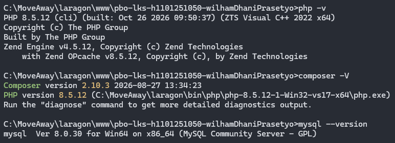
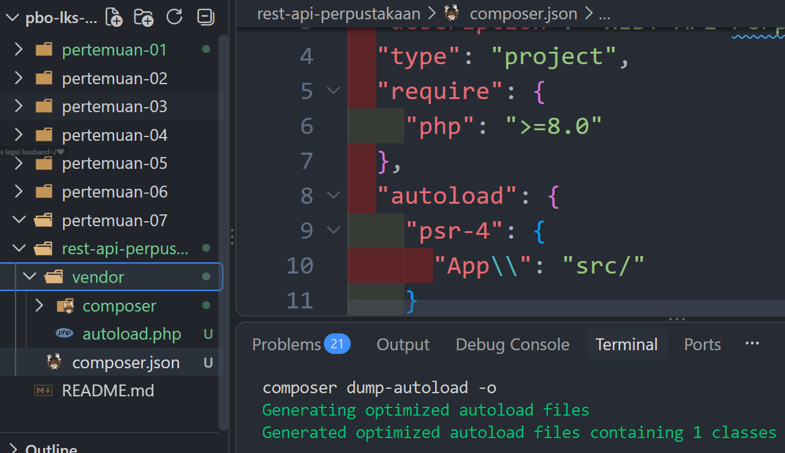
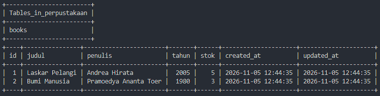
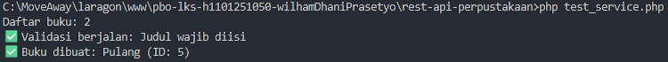
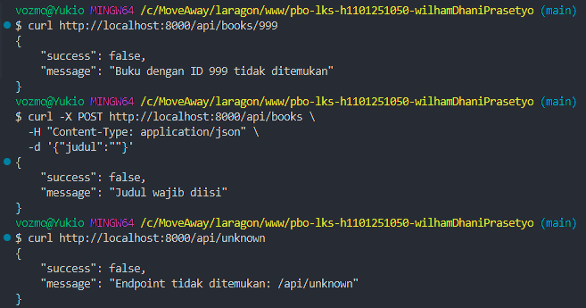
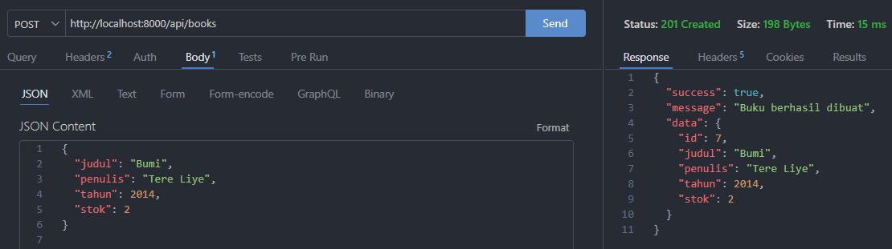
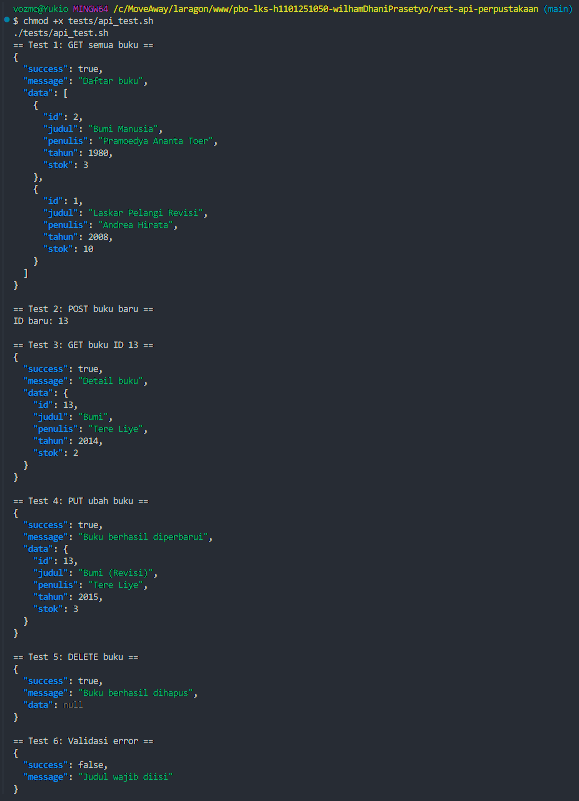
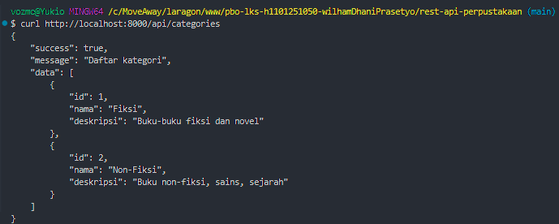
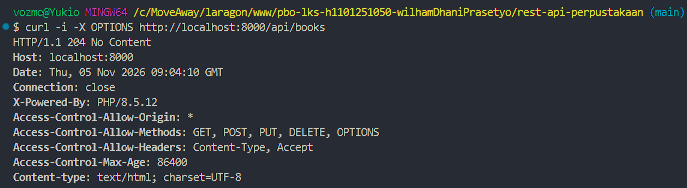
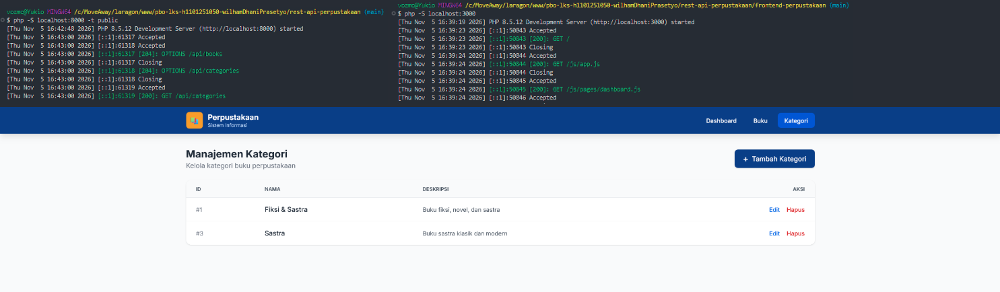

# PBO LKS — Portofolio Praktikum

- Nama : Wilham Dhani Prasetyo
- NIM : H1101251050
- Kelas: A

## Daftar Pertemuan
- [✓] Pertemuan 1 — Setup & Database
- [✓] Pertemuan 2 — Core OOP
- [✓] Pertemuan 3 — Framework & Routing
- [✓] Pertemuan 4 — Testing Backend
- [✓] Pertemuan 5 — CRUD Kategori
- [✓] Pertemuan 6 — Frontend
- [✓] Pertemuan 7 — Integrasi & Finalisasi

## Cara Menjalankan Aplikasi

Ikuti langkah-langkah berikut untuk menjalankan **REST API Perpustakaan** beserta frontend web secara lokal.

### Catatan Sebelum Memulai

- Pastikan PHP dan MySQL sudah terinstal dan dapat diakses melalui terminal.
- Pastikan layanan MySQL sedang berjalan sebelum menjalankan aplikasi.
- Pastikan port `8000` dan `3000` tidak sedang digunakan oleh aplikasi lain.
- Kedua terminal server harus tetap aktif selama aplikasi digunakan.
- Untuk menghentikan server, tekan `Ctrl + C` pada masing-masing terminal.

### 1. Persiapan Proyek

Clone repository atau download seluruh file proyek, kemudian ekstrak jika menggunakan ZIP.

Pastikan direktori proyek memiliki struktur seperti berikut:

```text
rest-api-perpustakaan/
├── database/
│   └── schema.sql
├── public/
├── frontend-perpustakaan/
├── .env.example
└── ...
```

### 2. Konfigurasi Environment

Salin file `.env.example` menjadi `.env` pada direktori utama proyek.

Kemudian, sesuaikan konfigurasi database di dalam file `.env` dengan pengaturan MySQL lokal yang digunakan.

```env
DB_HOST=127.0.0.1
DB_PORT=3306
DB_DATABASE=perpustakaan
DB_USERNAME=[USERNAME]
DB_PASSWORD=[PASSWORD]
```

Ganti `[USERNAME]` dengan username MySQL yang digunakan. `[PASSWORD]` dengan password username yang digunakan.

### 3. Setup Database

Buka terminal pada direktori utama proyek (`rest-api-perpustakaan`), kemudian jalankan perintah berikut untuk mengimpor struktur database:

```bash
mysql -u [USERNAME] -p < database/schema.sql
```

Ganti `[USERNAME]` dengan username MySQL yang digunakan. Masukkan password MySQL ketika diminta.

Pastikan proses import database berhasil sebelum melanjutkan ke tahap berikutnya.

Berikut salah satu contoh verifikasi:

```bash
mysql -u [USERNAME] -p -e "USE perpustakaan; SELECT * FROM categories;"
```

Apabila proses import berhasil, maka isi tabel (`categories`) akan ditampilkan di terminal.

### 4. Menjalankan Backend Server

Buka **Terminal Pertama**, kemudian arahkan direktori kerja ke folder utama proyek:

```bash
cd rest-api-perpustakaan
```

Jalankan backend server menggunakan PHP Development Server:

```bash
php -S localhost:8000 -t public
```

Backend server akan berjalan pada alamat:

```text
http://localhost:8000
```

**Penting:** Biarkan terminal pertama tetap berjalan selama aplikasi digunakan karena terminal ini menjalankan backend REST API.

### 5. Menjalankan Frontend Server

Buka **Terminal Kedua**, kemudian arahkan direktori kerja ke folder frontend:

```bash
cd rest-api-perpustakaan/frontend-perpustakaan
```

Jalankan frontend server menggunakan PHP Development Server:

```bash
php -S localhost:3000
```

Frontend server akan berjalan pada alamat:

```text
http://localhost:3000
```

**Penting:** Biarkan terminal kedua tetap berjalan selama aplikasi digunakan karena terminal ini menjalankan frontend web.

### 6. Mengakses Aplikasi

Setelah backend dan frontend berhasil dijalankan, buka browser pilihan dan akses alamat berikut:

**http://localhost:3000**

Aplikasi perpustakaan kini dapat digunakan melalui antarmuka frontend web, termasuk fitur CRUD (*Create, Read, Update, Delete*) yang terintegrasi dengan REST API.

## Screenshot

### Langkah 1 ⁜ Cek Lingkungan Pengembangan


### Langkah 2 ⁜ Struktur Folder & Composer PSR-4


### Langkah 3 ⁜ Konfigurasi .env & Skema Database


### Langkah 4 ⁜ Env Loader & Connection PDO
 dan Connection (PDO Singleton) sesuai prinsip SRP.")

### Langkah 5 ⁜ Model, Interface & Repository Book
, BookRepositoryInterface (kontrak — prinsip DIP), dan MySQLBookRepository (implementasi konkret).")

### Langkah 6 ⁜ BookService — Logika Bisnis


### Langkah 7 ⁜ Core Framework: Request, Response, Router, Container
.")

### Langkah 8 ⁜ BookController & Front Controller
.")

### Langkah 9 ⁜ Uji CRUD Buku dengan cURL
 menggunakan cURL.")

### Langkah 10 ⁜ Uji Validasi & Error Handling


### Langkah 11 ⁜ Uji dengan Postman


### Langkah 12 ⁜ Skrip Uji Otomatis


### Langkah 13 ⁜ CRUD Kategori — Schema & Repository
.")

### Langkah 14 ⁜ CRUD Kategori — Service, Controller & Route


### Langkah 15 ⁜ Uji CRUD Kategori
.")

### Langkah 16 ⁜ Aktifkan CORS di Backend


### Langkah 17 ⁜ Setup Frontend & Konfigurasi API
.")

### Langkah 18 ⁜ Halaman Dashboard & Buku
 agar frontend terhubung ke API.")

### Langkah 19 ⁜ Halaman Kategori & Integrasi Penuh


### Langkah 20 ⁜ Finalisasi & Push Repository
.")